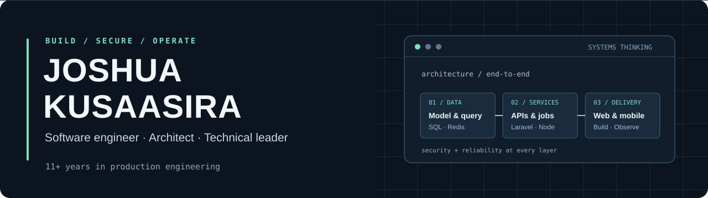

  

  <strong>Principal-level Software Engineer · Software Architect · Technical Leader</strong> 
  11+ years of professional engineering · Kampala, Uganda (UTC+3)

  <a href="https://www.linkedin.com/in/kusaasira">LinkedIn</a> ·
  <a href="https://www.stackoverflow.com/users/3186969/kusaasira-joshua">Stack Overflow</a> ·
  <a href="mailto:joshuakusaasira@gmail.com">Email</a> ·
  <a href="https://www.twitter.com/_kusaasira">X</a>

## Engineering that survives production

I architect, build and operate software that carries real business workflows. **PHP and Laravel are my deepest craft**, backed by substantial hands-on work across frontend, mobile, databases, cloud infrastructure and production operations.

I care about the complete system: a correct domain model, fast database queries, clean APIs, usable interfaces, predictable deployments, secure access and the ability to diagnose what happens at 2 a.m.

> **From the first schema design to the production incident.** I stay hands-on through architecture, implementation, delivery and operations.

## PHP / Laravel is home ground

Laravel is where I do my most consequential engineering, from modernizing mature applications to designing new platforms on Laravel 12 and 13. I work comfortably across legacy codebases and modern Laravel architecture.

- **Application architecture:** Eloquent, domain modeling, REST APIs, authorization, complex business rules, multi-user workflows and maintainable boundaries.
- **The modern Laravel ecosystem:** Filament, Livewire, Inertia, Horizon, queues, scheduled jobs, Sanctum, Passport, Fortify and Spatie packages.
- **Data-intensive systems:** Query plans, indexes, reporting and exports, transaction boundaries, migrations, background processing and caching.
- **Production discipline:** Pest/PHPUnit, static analysis, CI/CD, Nightwatch, Pulse, Telescope, backups and incident debugging.

Laravel isn't a framework I merely use. It's a platform I know how to **design around, extend, optimize, secure and keep running**.

## Full-stack capability

| Discipline | Tools and technologies |
| :-- | :-- |
| **Frontend** | TypeScript, JavaScript, Vue 2/3, React, Next.js, Angular 21, Inertia, Vite and Tailwind CSS |
| **Mobile** | React Native, Expo, Android and Kotlin |
| **Backend beyond PHP** | Node.js, NestJS, Express, Java/Spring Boot, Apache Fineract and Python/Django |
| **Data and asynchronous work** | PostgreSQL, PostGIS, MySQL, MariaDB, MongoDB, Redis, RabbitMQ, Kafka and ETL workflows |
| **Infrastructure** | Linux/Ubuntu, AWS, DigitalOcean, Docker, Kubernetes, Nginx, Apache and PHP-FPM |
| **Delivery and observability** | GitHub Actions, CircleCI, Jenkins, automated tests, release workflows, structured logs and production monitoring |

## Where the craft shows up

**Complex platforms and analytics.** Evolved mature, data-heavy Laravel systems into multi-user products. One major overhaul replaced an inherited reporting layer built around **~700 handwritten SQL queries** with more maintainable analytics and dashboards.

**Finance and operational software.** Worked across ERP, onboarding, lending, accounting, subscriptions and payment integrations. I think carefully about data semantics, authorization, idempotency and the operational consequences of a failed transaction.

**Geospatial and field operations.** Built backend workflows around geographic hierarchies, farmer and garden records, PostgreSQL/PostGIS, permission-aware data access and reliable reporting/export pipelines.

**Web and mobile delivery.** Built modern product interfaces with Vue, React and Angular plus React Native/Expo applications connected to real backend services. This includes content, onboarding, payments and wallet-related workflows.

**International platforms.** Helped localize **five production platforms into 26 languages**, building APIs, analytics and automation around multilingual operations.

## GitHub stats

A snapshot of the commits, contributions and consistency behind the craft.

  

## Beyond application code

I also own the infrastructure and engineering controls that make software dependable after it ships.

- **Linux and systems administration:** Server provisioning, Ubuntu/Linux operations, Nginx/Apache, PHP-FPM, performance profiling, service health and recovery.
- **Practical cybersecurity:** OAuth2, RBAC, least-privilege access, sensitive-data handling, WAF hardening, secure integrations and reviewing authorization boundaries.
- **Reliability engineering:** CI/CD, deployment safeguards, database backups and restores, observability, production incident response and performance tuning.
- **Architecture with operational awareness:** Database correctness, concurrency, background jobs, integrations, maintainable migrations and release risk.

## Technical leadership, still hands-on

I've guided **teams of up to 20 engineers** while staying close to system design, critical features, code reviews and production incidents. My approach is to build engineering judgment across a team, challenge risky assumptions early and raise the quality bar without slowing delivery to a crawl.

**What matters to me:** correctness, clear trade-offs, performance, security, accessible product experiences and software that the next engineer can maintain.

---

### Let's build something that lasts

I enjoy ambitious products, difficult legacy modernizations and teams that take craftsmanship seriously. If you're building something with meaningful technical depth, let's talk.

**[Connect on LinkedIn](https://www.linkedin.com/in/kusaasira)** · **[Email me](mailto:joshuakusaasira@gmail.com)**

Outside engineering: cinematography. Currently sharpening my Go skills.

Holopin collection

[View my Holopin board](https://holopin.io/@kusaasira)

